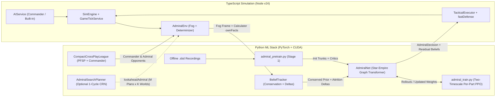
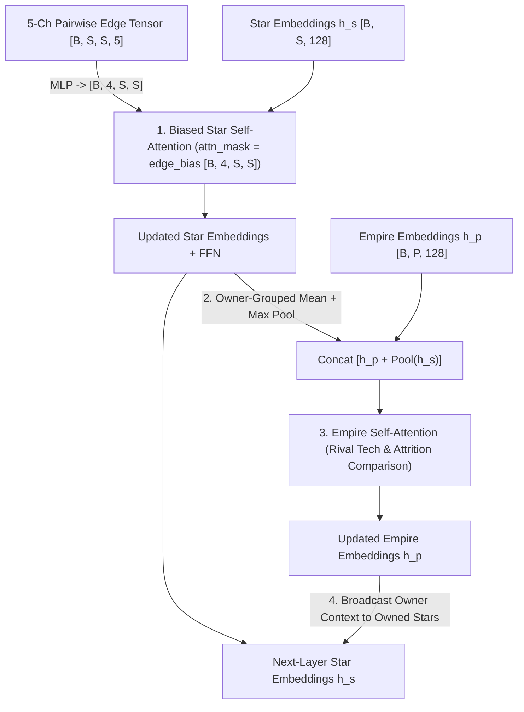
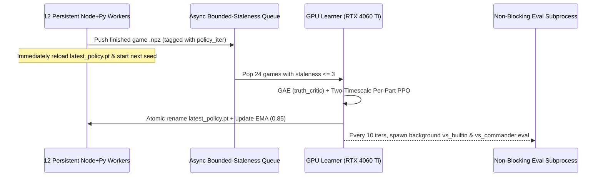

# Admiral: Architecture & Design Document

**Scope:** `server/sim/admiral/` (Self-contained parallel simulation, belief-inference, tactical execution, and reinforcement-learning stack for Solaris)

---

## 1. Executive Summary & Core Thesis

Solaris combines five properties that individually strain standard game-AI paradigms and jointly break most off-the-shelf reinforcement learning (RL) recipes:

1. **10-Player Non-Zero-Sum Free-For-All (FFA):** Bilateral attrition wars often lose to untouched third-party neighbors ("tragedy of the commons").
2. **Structured Partial Observability:** Fog of war, Nebulas, and Scramblers hide enemy garrisons, infrastructure, treasury, active research, and carrier waypoints — yet the **public scoreboard** continuously leaks exact per-empire totals.
3. **3,000-Tick Horizons & Exponential Scale:** Empires grow across three orders of magnitude (`10` ships at tick 1 to `50,000+` ships in late-game wars), with delayed 20-tick production cycles.
4. **Graph-Constrained Logistics:** Fleets move asynchronously along dynamic Euclidean + Hyperspace + Wormhole + Warp-Gate graphs, where multi-star coordination (`delayTicks`) determines whether fortified borders crack or hold.
5. **Single-Workstation Compute Budget:** Training must converge in hours on a single consumer GPU (`RTX 4060 Ti`, 8 GB VRAM) and a 12–14 thread CPU pool running full TypeScript game ticks.

> [!IMPORTANT]
> **Core Thesis of `Admiral`:** Neither pure end-to-end micro-action RL nor thin parameter-tuning over Solaris's built-in `AIService` (`Commander`) is optimal under these constraints. `Admiral` adopts a **semi-hierarchical architecture**: a **learned Heterogeneous Graph Transformer (`AdmiralNet`)** makes strategic, spatial, economic, and belief-residual decisions, while a **domain-exact operational solver (`TacticalExecutor`)** executes `O(1)` combat math, shortest-path routing, synchronized Time-on-Target invasions, and cycle-timed upgrades without artificial `AIService` ceilings.

---

## 2. Architectural Options Considered

Before building `Admiral` in [admiralEnv.ts](./admiralEnv.ts) and [tacticalExecutor.ts](./tacticalExecutor.ts), three control abstractions were evaluated:

| Dimension | Option A: Atomic Micro-Action RL | Option B: `AIService` Wrapper (`Commander`) | Option C: Strategic Policy + Tactical Solver (`Admiral`) |
| :--- | :--- | :--- | :--- |
| **What the Network Outputs** | Every carrier build, ship transfer, waypoint hop, and star upgrade on every tick. | Candidate order multipliers + preset spending plans + `AiConfig` scalar overrides. | Per-frontier-star continuous scores, 5-way Dirichlet budget, posture/rival focus, tactical knobs, research, specialist pointer, and belief residuals. |
| **Asymptotic Expressivity** | Maximal (any legal action sequence). | **Capped** by `AIService` rules (no multi-star ToT, no Warp Gates, hardcoded `5 * totalEconomy` carrier lockup, no assault specialists). | High: unlocks multi-star ToT, Warp-Gate highways, liquid carrier surges, triage, and conservation beliefs. |
| **Sample Complexity** | Intractable on 1 GPU ($\sim 10^{12}$ branching factor over 150 cycles; credit assignment stalls). | Very fast early learning (starts at built-in AI baseline). | Fast **once trunk is `.sbd` pre-trained** and policy heads are zero-initialized at domain priors. |
| **Compute Cost per Game** | Hundreds of GPU RPC round-trips per game. | ~25 cycle-boundary RPCs per game (`HOLD_ORDERS`). | ~25 cycle-boundary RPCs in training; `O(1)` combat math keeps tick execution fast. |

### Why Option A Was Rejected
In AlphaStar [1], an autoregressive pointer network over atomic unit commands required **thousands of TPU-days** and **human replay imitation** to bootstrap basic logistics before RL could even start. Without human Solaris replays for atomic carrier transfers, pure PPO from scratch spends millions of steps rediscovering how to ferry ships from interior shipyards to the border.

### Why Option B (`Commander`) Hit a Structural Ceiling
`Commander` (`server/sim/python/commander.py`) cleverly sidestepped early exploration by reweighting `AIService.proposeOrders()`. However, diagnostic traces against `Commander ema_1117.pt` revealed six hard constraints baked into `AIService` that no neural network sitting above it can override:
1. **Single-star invasion launches only:** If an enemy border star requires `90` ships and three adjacent own stars hold `40` each, `AIService` never attacks.
2. **Hardcoded carrier reserve (`totalEconomy * 5`):** At `363` Economy, `AIService` locks \$1,815 away from carrier purchases unless overridden via coarse `AiConfig` knobs.
3. **Zero Warp-Gate construction:** `AIService` never calls `buildWarpGate`, leaving late-game empires crawling at $1\times$ carrier speed instead of $3\times$ arterial warp highways.
4. **No carrier combat specialists:** `AIService` never hires `Siege Breaker` (`+4` attacker star weapons) or `Infiltrator` (`-1` enemy weapons).
5. **No doomed-star triage:** `AIService` continues buying infrastructure on stars 2 ticks away from enemy capture and trickles piecemeal reinforcements to their death.
6. **Unconstrained fog beliefs:** `Commander` predicts ship counts only on never-seen stars without enforcing that hidden ships sum to the opponent's public total.

### Why Option C (`Admiral`) Won — Plus the Co-Existence Constraint
`Admiral` follows the principle behind **Cicero** [2] and **Hierarchical / Options RL** [3]: *use neural networks for coupled global valuation, opponent modeling, and intent selection, and use exact combinatorial solvers for local physics, routing, and tactical synchronization*. Crucially, `Admiral` was engineered under a **strict zero-touch isolation rule**: it subclasses `AgentEnv` in [admiralEnv.ts](./admiralEnv.ts) without modifying a single line of `Commander` or server code, allowing both agents to play in the **same galaxy** and share `.sbd` (`SBD1`) belief recordings.

---

## 3. Fog-of-War Inference: Scoreboard Conservation & Residual Beliefs

### 3.1 Exploiting Solaris's Public-Private Structure
In most RTS games (e.g., StarCraft II), hidden enemy army size is completely unknown. In Solaris, `stats[q]` publicly broadcasts every player's **exact** total `stars`, `ships`, `carriers`, `economy`, `industry`, and `science` on every tick.

For any rival empire $q$, let $V_q$ be its currently scanned stars (`vis == VISIBLE` for ships; `vis != HIDDEN` for infrastructure), $H_q$ its hidden stars, and $C_q^{\text{vis}}$ its scanned carriers with visible ship counts. Then the **exact unseen ship remainder** is deterministic:

$$R_q^{\text{ships}} = \max\!\left(0,\; \text{PublicShips}_q - \sum_{s \in V_q} \text{ships}[s] - \sum_{c \in C_q^{\text{vis}}} \text{ships}[c]\right)$$

And similarly $R_q^{\text{eco}}, R_q^{\text{ind}}, R_q^{\text{sci}}$ are exact integers for hidden infrastructure! Inferring hidden garrisons is therefore **not** unconstrained regression in $[0, \infty)^S$ — it is a **probability distribution on the simplex** $\Delta^{|H_q|-1}$ scaled by $R_q$.

### 3.2 Physics-Informed Priors + Neural Log-Residuals
In [belief_tracker.py](./python/belief_tracker.py#L283-L445), `BeliefTracker` combines three sources of evidence:

1. **Deterministic Production Extrapolation & Ghost Carriers:**
   - For previously scanned stars (`seen_tick >= 0`), `BeliefTracker` extrapolates ship production over elapsed ticks $\Delta t$ using the star's last-seen industry and the owner's public `manufacturing` level:
     $$\hat{s}_i^{\text{prior}} = s_i^{\text{mem}} + \text{ind}_i^{\text{mem}} \cdot (\text{mfg}_q + 5) \cdot \frac{\Delta t}{\text{cycle}} + g_i^{\text{ghost}}$$
   - When an enemy carrier is spotted heading toward star $i$ and then flies out of scan range, `BeliefTracker` records a **ghost arrival** $g_i^{\text{ghost}}$ at `tick + eta` so unseen reinforcements are remembered.
   - For never-seen stars, the prior weights home capitals, frontier proximity to us, and non-nebula natural industry.
2. **Rolling Scoreboard-Delta Attrition (`delta_features`):**
   - Suppose Rival $q$ has `40` Industry and `Manufacturing 5` (expected growth: `+20` ships over 4 ticks), yet its public `totalShips` *drops* by `45`. Even if the battle occurred completely outside our scan range, `BeliefTracker.delta_features` ([belief_tracker.py](./python/belief_tracker.py#L239-L281)) computes:
     $$\text{attrition}_q = \max\!\left(0,\; \Delta s_q^{\text{expected}} - \Delta s_q^{\text{observed}}\right)$$
     exposing 10 rolling 4-tick and 1-cycle $\Delta$-features per empire to `AdmiralNet` so the policy immediately detects when a neighbor is bleeding out in an off-screen war!
3. **Additive Neural Residual Logits (`belief_head`):**
   - `AdmiralNet.belief_head` outputs 4 residual logits $\delta_{i,c}$ per star (`ships`, `economy`, `industry`, `science`), forming:
     $$w_i = \operatorname{softmax}_{i \in H_q}\!\left(\log \hat{s}_i^{\text{prior}} + \delta_{i,\text{ships}}\right), \qquad \hat{s}_i = w_i \cdot R_q^{\text{ships}}$$

> [!NOTE]
> **Lesson Learned (Avoiding Prior Double-Counting):** At `belief_head == 0` (zero-initialization), $\hat{s}_i$ starts exactly at `BeliefTracker`'s physics prior. Early on, training `belief_logits` directly against true ship shares *without* adding $\log \hat{s}_i^{\text{prior}}$ inside `compute_auxiliary_belief_loss` caused `constrain_beliefs` to apply the prior *twice* ($2\log \hat{s}_i^{\text{prior}}$) at runtime. Passing `star_x`'s prior estimate into [admiral_train.py](./python/admiral_train.py#L357-L428) made training and inference mathematically identical, mirror-matching ResNet-style residual learning [4] and public-belief-state decompositions in imperfect-information games [5, 6].

### Alternatives Considered for Belief Tracking
- **Recurrent LSTM/GRU across ticks:** Rejected because (a) async/batched PPO requires storing and truncating recurrent hidden states across variable-length 3,000-tick games, and (b) `SeatMemory` (`seen_tick`, `mem_ships`, `mem_infra`) + `BeliefTracker`'s rolling 1-cycle history already form an exact sufficient summary of past observations.
- **Sequential Monte Carlo (Particle Filtering):** Too expensive inside the inner training loop; instead, integer-conserved world sampling (`sample_belief_worlds` via largest-remainder rounding + Dirichlet concentration) is reserved for test-time `AdmiralSearchPlanner` rollouts.

---

## 4. Network Architecture: Heterogeneous Star $\leftrightarrow$ Empire Graph Transformer

### 4.1 Why `log1p` Scaling & Explicit Calculator Inputs Matter
Standard linear normalization (`ships / 100`) works at tick 20 (`15` ships $\to 0.15$) but produces activations $> 300$ in 2,500-tick late-game wars (`35,000` ships), saturating LayerNorms and destabilizing critic gradients. Every unbounded quantity in `build_admiral_inputs` ([admiral_net.py](./python/admiral_net.py#L125-L570)) — ships, infrastructure, carrier fleets, credits, ETAs, and marginal upgrade costs — is mapped through $\log(1 + x) / c$.

Furthermore, rather than forcing the neural network to memorize Solaris's non-linear floor-division infrastructure cost formulas (`common/src/services/infrastructureCost.ts`), `AdmiralEnv._computeOwnFacts` ([admiralEnv.ts](./admiralEnv.ts#L234-L325)) computes the **exact marginal credit cost** and **binary affordability flag** (`cost <= credits`) for `economy`, `industry`, `science`, and `warpGate` at every owned star and feeds them directly into `star_x` (`[S, 41]`).

### 4.2 Coupled Star $\leftrightarrow$ Player Graph Attention (`HeterogeneousBackbone`)
A Solaris galaxy has two coupled entity types at different scales: **`S = 200` Stars** (local geometry & garrisons) and **`P = 10` Empires** (global tech, treasury, diplomacy, and attrition). `HeterogeneousBackbone` ([admiral_net.py](./python/admiral_net.py#L575-L714)) runs `L = 4` coupled layers (`d = 128`, `H = 4` heads) where every layer performs four operations:

The **5-channel pairwise star edge tensor** (`edge_x [B, S, S, 5]`) encodes:
1. $\log(1 + \text{euclid\_ticks}) / 4.5$ (raw spatial distance),
2. $\log(1 + \text{hop\_ticks}) / 5.0$ (Floyd-Warshall shortest path along current hyperspace range),
3. `direct_jump` ($\mathbb{I}[\text{dist} \le \text{hs\_range}]$),
4. `fast_link` ($\mathbb{I}[\text{warpGate}_i \land \text{warpGate}_j]$),
5. `same_owner` ($\mathbb{I}[\text{owner}_i = \text{owner}_j \ge 0]$).

Projecting `edge_x` into additive attention-logit biases (`attn_mask` in `F.scaled_dot_product_attention`, following **Graphormer** [7] and relative-position Transformers [8]) lets every star attend across multi-hop hyperspace corridors in a single layer while still running on fused Flash/SDPA CUDA kernels.

> [!TIP]
> **VRAM & Disk Compression (`_build_gpu_edge_x`):** Naive `[N, 200, 200, 5]` float32 edge arrays would consume **1.2 GB per 1,500 rollout steps**! Because channels `0..2` depend only on `(galaxy_seed, own_hyperspace_level)` while channels `3..4` are outer products of `star_x[:, 14]` (warp gate) and `owner_rel`, [admiral_rollout.py](./python/admiral_rollout.py#L405-L425) deduplicates `float16 [K, 200, 200, 3]` slices (`K ~ 2–4` per game) and [admiral_train.py](./python/admiral_train.py#L339-L355) reconstructs `[B, 200, 200, 5]` directly in GPU SRAM per minibatch — cutting rollout I/O and RAM by **`> 25x`**.

### Alternatives Considered for the Backbone
- **2D Spatial CNNs:** Rejected because Solaris travel topology is non-Euclidean once Hyperspace jump thresholds, Wormholes, and Warp Gates are active.
- **Sparse 1-Hop Message-Passing GNNs (GAT/MPNN):** Requires many layers to propagate multi-cycle strategic threat across the map and runs slower than dense $200 \times 200$ PyTorch `scaled_dot_product_attention` on Tensor Cores.

---

## 5. Two-Stage Training: Why Scratch Transformer RL Collapsed & How `.sbd` Pre-Training Solved It

### 5.1 Post-Mortem of `admiral2` (302 Iterations from Scratch)
In `admiral2`, `AdmiralNet` was trained from random initialization directly via PPO at `lr = 1.8e-4`. Despite 302 iterations (~7,200 10-player games), external evaluation vs. `Commander ema_1117.pt` stayed completely flat (`5.00` vs `3.71`). Live inspection of `ema_300.pt` across ticks `1 -> 61 -> 141 -> 241` exposed **classic Transformer RL representation collapse** [9, 10]:
- `belief_loss` barely moved across 302 iterations (`2.56 -> 2.55`).
- Policy outputs became nearly state-independent constants (`budgetSplit` varied by `< 0.005` from tick 1 to tick 241!), fitting only a global static prior because noisy 10-player policy gradients overwhelmed the randomly initialized multi-head attention layers before meaningful star/empire features existed.

### 5.2 Stage 1: Multi-Task Supervised `.sbd` Pre-Training ([admiral_pretrain.py](./python/admiral_pretrain.py))
To eliminate cold-start collapse, `admiral_pretrain.py` trains **both** `backbone` (fog) and `critic_backbone` (omniscient truth) offline on `SBD1` `.sbd` recordings (`admiral` cross-play + `commander` league games) across five dense per-tick targets:

1. **4-Channel Conservation Residual KL (`belief_kl`):** Hidden `ships`, `economy`, `industry`, and `science` residuals on top of `BeliefTracker`.
2. **Star Tactical Threat (`threat_l1`, $2\times$ weighted on fog-hidden stars):** True $\log(1 + \text{ships})$, 1-cycle enemy reach threat, and 1-cycle incoming carrier ships (predicting residuals over `BeliefTracker` & visible inbound fleets).
3. **Opponent Hidden State (`opp_cred_l1` + `opp_res_ce`):** Hidden rival `credits`, `creditsSpecialists`, and 8-way `researchingNow` classification.
4. **Dual Distributional Outcome Critics (`fog_rank_ce` + `truth_rank_ce`):** 10-way cross-entropy over final game placement (`1st..10th`).
5. **2-Cycle Spatial Expansion (`expand_bce`):** Binary cross-entropy on whether `seat` owns each star $2$ production cycles in the future.

Crucially, **all policy heads remain untouched at their zero-initialized priors** during Stage 1. Across `600` games (`14,400` samples, 3.5 minutes on RTX 4060 Ti), held-out validation error on `60` unseen games dropped dramatically (`threat_l1`: `0.1221 -> 0.0359`, **`-70.6%`**; `opp_res_acc`: `21.9% -> 44.0%`; `fog_rank_ce`: `2.307 -> 1.743`).

### 5.3 Stage 2: Two-Timescale Fine-Tuning (`LP-FT` Principle)
As shown by Kumar et al. [11] (*Fine-Tuning Can Distort Pretrained Features*), applying a large RL learning rate to randomly initialized heads attached to a pre-trained trunk sends large early gradients backward into the trunk, distorting pre-trained features. `make_admiral_optimizer` ([admiral_train.py](./python/admiral_train.py#L79-L92)) therefore uses **two-timescale AdamW**:
- **Pre-trained trunk + belief head:** `LR_TRUNK = 1.5e-5`
- **Policy & value heads:** `LR_HEADS = 8.0e-5` (`~5.3x` faster)

---

## 6. Factored Action Space & Domain Priors

`AdmiralNet` ([admiral_net.py](./python/admiral_net.py#L847-L1140)) factors each cycle's strategic decision into **8 action parts (`PART_NAMES`)** grouped into 4 semantic families:

| Part (`Group`) | Distribution | Role & Design Rationale |
| :--- | :--- | :--- |
| **`frontier`** (`spatial`) | Masked `Normal` (`[B, S]`, active on $\le 32$ reachable frontier stars) | Continuous log-multipliers $\in [-2, 2]$ (`desire *= exp(f_i)`) giving fine-grained per-star claim & invasion targeting without variable-length candidate padding. |
| **`posture`** (`spatial`) | `Categorical(5)` | Macro stance: `balanced`, `expand`, `conquer`, `fortify`, or **`warp_surge`** (late-game arterial Warp-Gate + carrier blitz). |
| **`target_player`** (`spatial`) | Masked `Categorical(P)` | Focuses invasions ($2.2\times$) against a chosen weak/bordering rival empire (or `0` = opportunistic), seeded with a proximity prior (`-0.85 * dist`). |
| **`budget`** (`budget`) | `Dirichlet(5)` | Continuous simplex split `[science, industry, economy, warpGate, carrierCash]`. Unlike Softmax-Gaussian heads, a **Dirichlet** [12] lives natively on $\Delta^4$ with exact analytic log-density and entropy. |
| **`knobs`** (`knobs`) | `Normal(3)` | Log-space multipliers around domain defaults for `attackMargin` (`3.2`), `maxAttackTicks` (`42`), and `triageThreshold` (`0.85`). |
| **`research`** (`macro`) | Masked `Categorical(1 + T)` | Per-tech MLP reading `[g, lvl, gap_to_wm, enemy_lead, log_req, progress_frac, prior]`, plus `decode_admiral_decision` sets `researchNext` to avoid random mid-cycle rollovers. |
| **`spec`** (`macro`) | Masked `Categorical(19)` | Chooses `keep/save` (`0`) or affordable star specialist (`Research Station` id 11, `Space Dock` id 2, `Orbital Cannon` id 4). |
| **`spec_star`** (`macro`) | Conditional `Categorical(S)` | **Pointer head** [13] conditioned on chosen `spec`, scoring free owned stars (e.g. high-science interior stars for `Research Station`). |

### Key Iteration Discovery: Unshackling `Weapons` & `Manufacturing`
In `admiral2`, `CORE_TECH_NAMES` originally included `("weapons", "manufacturing", "terraforming")` with a heavy penalty whenever any tech ran ahead of the minimum of those three. Side-by-side traces at Tick 401 showed `Admiral` researching **`terraforming = 11, weapons = 11`**, while `Commander ema_1117` stopped `terraforming` at `2` and pushed **`weapons = 16, manufacturing = 11`** — winning every battle by $+33\%$ kills per round! Restricting `CORE_TECH_NAMES` to `("weapons", "manufacturing")` and tapering `terraforming >= 3` / `hyperspace >= 4` / `banking >= 3` immediately fixed late-game combat scaling while keeping all techs freely overridable by `research_tech_head`.

---

## 7. Tactical Solver (`TacticalExecutor`) & `O(1)` Combat Engine

### 7.1 `O(1)` Bulk-Round Combat & Binary-Search Sizing ([fastDefense.ts](./fastDefense.ts))
Solaris combat alternates simultaneous strikes of $W_d + B$ (defender) and $W_a$ (attacker). Standard `CombatService` loops 1 round at a time and searches `shipsNeeded` by stepping 1 ship at a time — consuming over half of total CPU time in large late-game battles.
- `fastFight` skips all constant-damage bulk rounds in **one integer division** (`Math.min(floor((d - dTotal) / W_a), floor((a - W_a) / dTotal))`) and finishes the 1–2 tail rounds exactly.
- `fastEstimateNeeded` replaces linear ship stepping with exponential doubling + binary search ($O(\log N)$), verified **bit-for-bit identical** to `CombatService` in [admiral.spec.ts](./admiral.spec.ts).

### 7.2 Hybrid Coordinated Invasions (Mode A + Mode B)
Early versions of `_executeCoordinatedInvasions` attempted unconstrained multi-hop Time-on-Target across arbitrary own stars. Profiling revealed a subtle failure mode: rear stars `35` ticks away caused adjacent border stars `8` ticks away to sit paralyzed in `delayTicks = 27` orbits, locking up **85% of the empire's ships** and starving neutral expansion!

The production solver in [tacticalExecutor.ts](./tacticalExecutor.ts#L1762-L2120) uses a **two-mode hybrid** that preserves multi-star breakthroughs with zero fleet lockup:
- **Mode A (Synchronized Border Time-on-Target):** Coordinates `1..3` direct border stars within `directTickCap <= 26` ticks whose ETAs differ by **at most `8` ticks** (`delayTicks = syncTick - item.eta <= 8`), optionally hiring a **`Siege Breaker` (`+4` weapons)** on the lead carrier when `req >= 50` and `tSync <= 14`.
- **Mode B (Single-Armada Multi-Hop Strike):** If border stars alone cannot crack the target, searches rear shipyards along `ownGraph` (including $3\times$-speed Warp-Gate highways!) for a **single** rear star holding $\ge \text{req}$ surplus ships and dispatches a zero-delay multi-hop strike through the border jump star.
- **Visibility-Aware Fog Margin:** Actively scanned targets (`VISIBLE`) scale `attackMargin` by $0.65\times$ (floor $1.3\times$) since garrison size is known exactly, whereas fog-hidden targets retain the full safety margin on top of `BeliefTracker`'s ship + industry estimates.

### 7.3 Cycle-Boundary Economics & `cycleEcoHold` Liquidity
Solaris resolves research on every tick (`1..20`), ship manufacturing on every tick (`1..20`), and Economy/Banking payouts **only on tick 20** (`tick % 20 == 0`). `TacticalExecutor._spendCycleCredits` ([tacticalExecutor.ts](./tacticalExecutor.ts#L1170-L1290)) exploits this exact tick order:
- **Tick 1 of Cycle (`isFirstTick`):** Spends `science`, `industry`, and `warpGate` shares immediately (weighted $2.2\times$ onto `Research Station` and `Space Dock` stars) so new Science & Industry compound across all 20 ticks of the cycle, while recording `cycleEcoHold = floor(totalCredits * normSplit[2])`.
- **Ticks 1..18:** `carrierCash` (`normSplit[4]`) remains **100% liquid** for carrier surges (replacing `AIService`'s rigid `totalEconomy * 5` lockup).
- **Tick 19 (`isLastTick`):** Releases `cycleEcoHold` into highest-ROI safe interior Economy upgrades 1 tick before payout — keeping emergency cash liquid all cycle with zero lost interest!

### 7.4 Token-Conserving Claims, Returning Ferries, and Triage
- **Specialist Token Discipline:** Players start with `5` specialist tokens — the exact cost of a `Research Station` (`id: 11`, $2\times$ science). `_dispatchExplorers` ([tacticalExecutor.ts](./tacticalExecutor.ts#L1484-L1668)) withholds `3`-token `Explorer` carrier hires whenever normal hyperspace claims exist and `tokens < 8`, preventing early `Explorer` hires from starving `Research Station` deployment.
- **Returning-Ferry & `collectAll` Logistics:** Interior shipyards route surplus ships along `nextHop` gradients toward frontier stars using round-trip ferries (`dropAll` $\to$ return) or multi-star `collectAll` sweeps, tracking `busyLogisticsStars` so interior stars wait for their returning ferry instead of burning \$25/cycle on disposable carriers.
- **Doomed-Star Triage (`_triageAndDefend`):** Groups inbound enemy carriers by `(star, eta)`. If reachable friendly reinforcements meet `neededExtra * triageThreshold`, exact defenders are locked and timed to arrive before impact; otherwise the star is marked `doomedStars` (withholding hopeless reinforcements and skipping infrastructure purchases). *(See Section 10.2 for queued `_evacuateStar` rear-guard refinements.)*

---

## 8. RL Optimization, Asymmetric Critics & Cross-Play League

### 8.1 Asymmetric Distributional Actor-Critic (`CTDE`)
Following **Asymmetric Actor-Critic** [14] and **C51 Distributional RL** [15], `AdmiralNet` maintains two separate `DistributionalValueHead` critics ([admiral_net.py](./python/admiral_net.py#L716-L735)):
- **`truth_critic` (Training Advantage Baseline):** Reads omniscient `truthFrame` + `truthFacts` (true hidden ships, carriers, enemy credits, and research progress), eliminating partial-observability variance from GAE (`GAMMA = 0.995, GAE_LAMBDA = 0.95`) during PPO training.
- **`fog_critic` (Test-Time Search Evaluator):** Reads only the fog-legal `backbone` representation, trained alongside the policy so `AdmiralSearchPlanner` can score lookahead leaves without privileged state.
- **10-Rank Distributional Prediction:** Instead of regressing scalar MSE on noisy FFA returns, both critics output **10-way logits over final placements `1..10`** trained via cross-entropy, computing expected value via $V = \sum_{r=1}^{10} p_r \cdot \left(1 - \frac{2(r-1)}{9}\right) + V_{\text{bonus}}$.

### 8.2 Independent Per-Part Ratio Clipping & `DUAL_CLIP`
Summing log-probabilities across all 8 heads into a single scalar $\log \pi_{\text{total}}$ creates a severe pathology: `frontier` sums up to 32 continuous Gaussian log-densities, so small changes in `frontier` variance push $\exp(\Delta \log \pi_{\text{total}})$ outside $[1 - \epsilon, 1 + \epsilon]$ and prematurely clip `research`, `budget`, and `posture` gradients!

`ppo_update` ([admiral_train.py](./python/admiral_train.py#L617-L834)) therefore clips **each of the 8 `PART_NAMES` (and each individual active frontier star / knob column) independently**, combined with **Dual-Clip PPO** (`DUAL_CLIP = 3.0`, Ye et al. [16]) to bound negative-advantage off-policy spikes from async workers:

$$\mathcal{L}_{\text{part}}(r, \hat{A}) = \begin{cases} \min\big(r \hat{A},\; \operatorname{clip}(r, 1-\epsilon, 1+\epsilon)\hat{A}\big) & \hat{A} \ge 0 \\ \max\!\Big(\min\big(r \hat{A},\; \operatorname{clip}(r, 1-\epsilon, 1+\epsilon)\hat{A}\big),\; c_{\text{dual}} \hat{A}\Big) & \hat{A} < 0 \end{cases}$$

If epoch-mean KL exceeds `TARGET_KL = 0.045`, actor updates halt cleanly while `truth_critic` and detached `fog_critic` / `belief_head` layers finish their remaining epochs so value estimates never lag behind.

### 8.3 Straggler-Free Async Rollouts & Anti-Dilution Cross-Play League

- **Why `--async-rollouts` Matters** ([admiral_train.py](./python/admiral_train.py#L960-L1066)): Solaris game lengths have heavy right tails (`300` ticks for quick knockouts vs `2,500+` ticks for stalemates). Under synchronous `Pool.imap` barriers, 11 workers sit idle waiting on 1 slow game. Following **IMPALA / Sample Factory** [17, 18], workers pull continuously from `latest_policy.pt` (`mean_staleness ~ 0.65` iterations, dropping any rollout with `staleness > 3`).
- **3-Tier Variance-Peaked PFSP Cross-Play League** (`CompactCrossPlayLeague`):
  - **45%** recent frontier `Admiral` EMAs (prevents rock-paper-scissors cycling),
  - **Bell-shaped PFSP** ($w_i \propto \exp(-((p_i - 0.42)/0.22)^2)$ [1]) across historical `Admiral` snapshots **and** imported `Commander` checkpoints (`data/league1/ema_*.pt`), focusing compute on opponents that *just barely beat* the learner,
  - **Built-in & Flawed Persona AIs** (`personas.py`) in remaining seats so the policy never forgets how to exploit weak/rusher/turtle empires, plus an **adaptive `Commander` shark cap** (`1` shark while mean win rate $< 25\%$, unlocking full multi-shark lobbies above $45\%$).

---

## 9. Test-Time Planning: 1-Cycle Fog-Legal Determinized Lookahead

At evaluation or deployment (`--search`), `AdmiralSearchPlanner` ([admiral_agent.py](./python/admiral_agent.py#L240-L388)) adds online search at cycle boundaries (`tick % 20 == 1`) without violating fog of war:

1. **Policy Proposal ($M$ Plans):** Generates Candidate `0` (greedy policy mode) plus $M - 1$ temperature-diversified policy samples (`T = 1.15`), inspired by **Cicero / MuZero** sampled-action search [2, 19].
2. **Conservation-Exact Determinization ($K$ Worlds):** Samples $K$ integer-exact `BeliefWorld`s from `BeliefTracker.sample_belief_worlds` using `AdmiralNet`'s learned residual logits.
3. **Strict Information-Set Scrubbing (`_buildDeterminizedWorld`):** In [admiralEnv.ts](./admiralEnv.ts#L497-L588), hidden star ships/infra are replaced by `world`, unseen enemy carriers are deleted, visible enemy carriers have waypoints truncated to hop `0` (and ship counts scrubbed if Scrambled/Nebula), hidden enemy credits/progress are reset, and opponent seats run the fast built-in AI — guaranteeing **zero information leakage** [20].
4. **Common Random Numbers (CRN) Rollout & Leaf Valuation:** Each `(plan_m, world_k)` pair rolls forward 20 ticks using **identical RNG seed `seed + k * 997` across all plans** [21], cancelling combat/map noise when scoring leaves via `fog_value + 0.25 * empire_share`.

---

## 10. Empirical Progression & Next-Step Roadmap

### 10.1 Measured Progression Across Iterations (`10`-Player Standard Galaxy)
All external benchmarks below use the fixed `eval.jsonl` protocol (`16` games = `48` `Admiral` seats; head-to-head pits `3` `Admiral` seats + `3` `Commander ema_1117.pt` seats + `4` Built-in seats in the same galaxy):

| Milestone | vs Built-in Mean Place (`Top-3%`) | Head-to-Head vs `Commander ema_1117.pt` | Key Architectural Change Validated |
| :--- | :--- | :--- | :--- |
| **`admiral1` Iter 0 (Initial)** | `4.61` (`38.9%`) | Lost (`~5.8` vs `3.4`) | Initial `TacticalExecutor` before multi-hop ToT & token fixes. |
| **Executor + Conservation Baseline** | `3.36` (`61.1%`) | `4.98` vs `3.71` (`-1.27` adv) | Fixed multi-hop ToT lockup, Research Station token conservation, & visibility margins. |
| **`admiral2` Iter 300 (Scratch PPO)** | `3.54` (`62.5%`) | `5.00` vs `3.71` (`-1.29` adv) | **Diagnosed bottleneck:** Scratch Transformer collapse + `terraforming=11` cap + `5 * totalEconomy` lockup. |
| **`admiral_v3` + `.sbd` Pretrain (Iter 0)** | `2.92` (`75.0%`) | **`3.88` vs `4.96` (`+1.08` adv)** | `.sbd` pre-trained trunk + unshackled `weapons`/`mfg` + `cycleEcoHold` + hybrid ToT solver. |
| **`admiral3` Iter 120 (Live PPO)** | `2.65` (`77.1%`) | **`3.94` vs `4.65` (`+0.71` adv)** | Two-timescale per-part PPO + `frontier_head` + `"warp_surge"` posture. |
| **`admiral3` Iter 200 (Live PPO)** | `2.58` (`81.3%`) | `4.06` vs `4.50` (`+0.44` adv) | Sustained self-play + cross-play improvement with zero trunk collapse (`belief_loss ~ 2.36`). |
| **`admiral3` Iter 450–490 (`ema_450` / `ema_490`, 24 Fresh Seeds)** | **`2.51` (`81.9%`, `24/24` wins)**; `2.61` vs Held-Out Personas | **`3.74` vs `4.93` (`+1.19` adv, `26.4%` vs `6.9%` wins)** | Completed 500-iter run (`50/50` eval wins vs `Commander`) + context-aware `_shouldStandAndBleed` / rear-guard evacuation. |
| **`admiral3` `ema_490` + `--search` (`4` Plans $\times$ `2` Worlds)** | — | **`3.50` vs `4.78` (`+1.28` adv, `27.8%` vs `5.6%` wins)** | 1-cycle fog-legal CRN determinized lookahead lifts win rate to **$5\times$ `Commander`**. |

### 10.2 Context-Aware Evacuation (Implemented) & Future Roadmap
1. **Context-Aware Garrison Evacuation (`_shouldStandAndBleed` & `_evacuateStar` in [tacticalExecutor.ts](./tacticalExecutor.ts#L864-L1035), Implemented):**
   - *Rear-Guard Rule:* Leaves `1` locked ship behind (`poolWithFirstCarrier - 1`) on doomed stars; Solaris retains the full defender bonus even when $d < W_d + B$ (`strike = 1 + B`), dealing `2–4` kills vs `0` casualties on a full pullout.
   - *Carrier Cost Gate:* Skips spending \$25 on a new evacuation carrier unless rescuing $\ge 10$ ships, while rescuing already-orbiting idle carriers freely.
   - *Stand-and-Bleed Counter-Punch:* Holds the garrison to bleed the attacker whenever effective strike and realized kill ratios satisfy $\ge 1.25$ and an adjacent friendly star within jump range can immediately counter-capture the weakened survivors.
2. **Formal Diplomacy Head (`court` / `betray`):** `AdmiralEnv` already wires `dec.court` and `dec.betray` ([admiralEnv.ts](./admiralEnv.ts#L129-L131)); adding an explicit diplomacy action head conditioned on `h_p` enables timed alliances in `diplomacy: "enabled"` presets.
3. **Expert Iteration with `AdmiralSearchPlanner`:** Recording 1-cycle lookahead search winners as auxiliary policy targets (AlphaZero / Expert Iteration [22]) to amortize 1-cycle tactical lookahead directly into single-pass `AdmiralNet` weights.

---

## 11. References

1. **Vinyals, O., Babuschkin, I., Czarnecki, W. M., et al. (2019).** *Grandmaster level in StarCraft II using multi-agent reinforcement learning (AlphaStar).* **Nature**, 575, 350–354. *(Supervised pre-training before RL, pointer/entity transformers, and Prioritized Fictitious Self-Play).*
2. **Meta Fundamental AI Research Diplomacy Team (Bakhtin, A., Brown, N., Dinan, E., et al.) (2022).** *Human-level play in the game of Diplomacy by combining language models with strategic reasoning (Cicero).* **Science**, 378(6624), 1067–1074. *(Separating high-level multi-player strategic intent proposals from domain-grounded tactical solvers in non-zero-sum multi-agent games).*
3. **Sutton, R. S., Precup, D., & Singh, S. (1999).** *Between MDPs and semi-MDPs: A framework for temporal abstraction in reinforcement learning.* **Artificial Intelligence**, 112(1–2), 181–211. *(Temporal and operational abstraction over multi-tick production cycles).*
4. **He, K., Zhang, X., Ren, S., & Sun, J. (2016).** *Deep Residual Learning for Image Recognition.* **CVPR 2016**. *(Zero-initialized residual parameterization on top of strong identity/domain baselines).*
5. **Moravčík, M., Schmid, M., Burch, N., et al. (2017).** *DeepStack: Expert-level artificial intelligence in heads-up no-limit poker.* **Science**, 356(6337), 508–513. *(Public-private belief state decomposition).*
6. **Brown, N., Bakhtin, A., Lerer, A., & Gong, Q. (2020).** *Combining Deep Reinforcement Learning and Search for Imperfect-Information Games (ReBeL).* **NeurIPS 2020**. *(Public belief state value estimation & search).*
7. **Ying, C., Cai, T., Luo, S., et al. (2021).** *Do Transformers Really Perform Badly for Graph Representation? (Graphormer).* **NeurIPS 2021**. *(Shortest-path distance and edge-feature biases injected directly into Transformer self-attention).*
8. **Shaw, P., Uszkoreit, J., & Vaswani, A. (2018).** *Self-Attention with Relative Position Representations.* **NAACL 2018**; see also **Hu, Z., et al. (2020)**, *Heterogeneous Graph Transformer*, **WWW 2020**. *(Pairwise relational biases and coupled multi-type Star $\leftrightarrow$ Empire graph attention).*
9. **Parisotto, E., Song, H. F., Rae, J. W., et al. (2020).** *Stabilizing Transformers for Reinforcement Learning (GTrXL).* **ICML 2020**. *(Instability and representation collapse of scratch Transformers under on-policy RL gradients).*
10. **Schwarzer, M., Anand, A., Goel, R., et al. (2021).** *Data-Efficient Reinforcement Learning with Self-Predictive Representations (SPR).* **ICLR 2021**. *(Dense auxiliary state/future prediction preventing RL representation collapse).*
11. **Kumar, A., Raghunathan, A., Jones, R., Ma, T., & Liang, P. (2022).** *Fine-Tuning Can Distort Pretrained Features and Underperform Out-of-Distribution (LP-FT).* **ICLR 2022**. *(Theoretical and empirical justification for protecting pre-trained trunks with smaller learning rates while adapting randomly initialized heads).*
12. **Chou, P.-W., Maturana, D., & Scherer, S. (2017).** *Improving Stochastic Policy Gradients in Continuous Control with Deep Reinforcement Learning using the Beta Distribution.* **ICML 2017**. *(Bounded/simplex policy parameterizations via Beta/Dirichlet distributions vs. unbounded Gaussians).*
13. **Vinyals, O., Fortunato, M., & Jaitly, N. (2015).** *Pointer Networks.* **NeurIPS 2015**; and **Andrychowicz, M., et al. (2021)**, *What Matters In On-Policy Reinforcement Learning?*, **ICLR 2021**. *(Entity-pointer heads and zero/small-scale last-layer initialization).*
14. **Pinto, L., Andrychowicz, M., Welinder, P., Zaremba, W., & Abbeel, P. (2018).** *Asymmetric Actor Critic for Image-Based Robot Learning.* **RSS 2018**. *(Omniscient privileged `truth_critic` during training paired with partial-observation actor).*
15. **Bellemare, M. G., Dabney, W., & Munos, R. (2017).** *A Distributional Perspective on Reinforcement Learning (C51).* **ICML 2017**. *(Predicting categorical outcome/rank distributions rather than scalar expectation MSE).*
16. **Schulman, J., Wolski, F., Dhariwal, P., Radford, A., & Klimov, O. (2017).** *Proximal Policy Optimization Algorithms.* **arXiv:1707.06347**; and **Ye, D., et al. (2020)**, *Mastering Complex Control in MOBA Games with Deep Reinforcement Learning (Dual-Clip PPO)*, **AAAI 2020**. *(Clipped surrogate objective and `DUAL_CLIP` stabilization for negative-advantage off-policy trajectories).*
17. **Espeholt, L., Soyer, H., Munos, R., et al. (2018).** *IMPALA: Scalable Distributed Deep-RL with Importance Weighted Actor-Learner Architectures.* **ICML 2018**.
18. **Petrenko, A., Huang, Z., Kumar, T., Sukhatme, G., & Koltun, V. (2020).** *Sample Factory: Egocentric 3D Control from Pixels at 100000 FPS with Asynchronous Reinforcement Learning.* **ICML 2020**. *(Single-node asynchronous rollout queues with bounded policy staleness).*
19. **Schrittwieser, J., Antonoglou, I., Hubert, T., et al. (2020).** *Mastering Atari, Go, Chess and Shogi by Planning with a Learned Model (MuZero).* **Nature**, 588, 604–609.
20. **Long, J., Sturtevant, N. R., Buro, M., & Furtak, T. (2010).** *Understanding the Success of Perfect Information Monte Carlo Sampling in Game Tree Search.* **AAAI 2010**; and **Browne, C. B., et al. (2012)**, *A Survey of Monte Carlo Tree Search Methods*, **IEEE TCIAIG**. *(Information-set determinization under imperfect information).*
21. **Glasserman, P. (2003).** *Monte Carlo Methods in Financial Engineering* (Ch. 4: Variance Reduction / Common Random Numbers). **Springer**. *(Paired RNG seeds across candidate plans on each sampled belief world).*
22. **Anthony, T., Tian, Z., & Barber, D. (2017).** *Thinking Fast and Slow with Deep Learning and Tree Search (Expert Iteration).* **NeurIPS 2017**.
